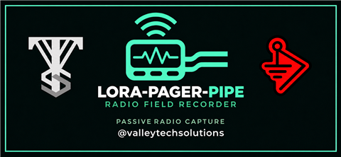
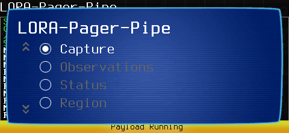

# LORA-Pager-Pipe

LORA-Pager-Pipe is a passive radio field recorder for the Hak5 WiFi Pineapple Pager. It captures LoRa packets through the Glytch Mesh module, identifies supported Meshtastic and MeshCore traffic, and retains the original packet bytes with radio settings and receiver GPS status. Native Pager Wi-Fi recordings can be attached to the same session for export.

**Development version 0.1.0. Hardware validation is in progress.** See the [device validation record](docs/VALIDATION.md) for completed checks and remaining tests. The payload is designed for review as source code; it does not include a custom executable or require an ESP32 LORA Tunnel installation.

## Hardware and installation

- [Hak5 WiFi Pineapple Pager](https://shop.hak5.org/products/pager)
- [Glytch Mesh mod](https://shop.hak5.org/products/glytch-mesh-mod-for-pager), SX1262 through CH341 USB-SPI, `1a86:5512`
- A supported external GPS receiver and working gpsd service for receiver locations

Install the complete `LORA-Pager-Pipe` directory under `/root/payloads/user/reconnaissance/`. Launch it from Payloads, choose the correct LoRa region and protocol, then open Capture. See [installation and recovery](docs/INSTALL.md) for dependencies and manual setup.

The first region is intentionally unset in distributed source. The supplied profiles cover US/Canada, EU868, and Australia/New Zealand. Select a profile appropriate for both the location and radio variant. The payload never transmits LoRa packets.

Use the Pager's directional buttons and A/B controls to open Capture, Observations, Status, Region and Upload settings. The menu remains available while LoRa capture runs. The image above is the payload running on the physical Pager.

## Capture and decoding

The Glytch module exposes a radio directly over USB-SPI. It does not run LoRaPipe's microcontroller firmware. LORA-Pager-Pipe therefore provides two receiver backends:

1. A native CH341/SX1262 receiver for the Glytch module.
2. A serial adapter for devices running the actual [LoRaPipe firmware](https://github.com/krak3n77/lorapipe).

Both feed the same raw-packet recorder and independent protocol decoders. This follows LoRaPipe's separation of radio capture from host interpretation, with the Pager doing the host work. It is a separate implementation from the ESP32 LORA Tunnel project.

Meshtastic decoding includes supported channel-encrypted traffic using the public default key, text, node information, advertised positions and selected telemetry. MeshCore decoding includes verified signed advertisements and supported Public-channel messages. Unsupported, encrypted, invalid-signature and bad-CRC traffic remains identified as such. This does not break encryption or recover private keys.

Meshtastic and MeshCore can run separately or alternate in **Both / slow scan**. One SX1262 receives one frequency and modem configuration at a time. Each default dwell is 30 seconds; packets on the other profile during that dwell are missed. Local communities may use other settings. The bundled presets are starting points, not universal discovery.

## Wi-Fi alongside LoRa

Leave the Pager's Recon service running. Start a native Wi-Fi recording through Recon, then choose **LoRa + existing Wi-Fi**. The payload leaves that recording under Recon control. Stop the native recording before attaching its CSV or PCAP from Uploads and exports.

Tri-band coverage depends on the Pager's native interface and selected band/channel list. The native hopping interface visits 2.4, 5 and 6 GHz channels over time; it does not hear every channel continuously. This version does not add BLE capture.

## Local session files

Sessions live under `/root/loot/lora-pager-pipe/` with private file permissions.

| File | Contents |
| --- | --- |
| `session.json` | Schema, selected profiles, start/end times, completion state and counters |
| `observations.jsonl` | Every saved packet, raw hex, radio metadata, decoder result and receiver GPS status |
| `capture.sqlite3` | Observation history and separate device summaries |
| `lora.pcap` | Raw packets with LoRaTAP metadata, PCAP link type 270 |
| `status.json` | Current profile, receive/write/drop counters and GPS state |
| `wifi.csv`, `wifi.pcap` | Snapshots of explicitly attached native recordings |
| `.uploads/exports/` | Validated service-specific export files |
| `.uploads/<service>/` | Per-account upload receipts and resumable processing states |

The SQLite file uses this project's schema. It is **not** a native Kismet `.kismet` database. LoRaTAP is the same packet metadata format used by Kismet's LoRaPipe capture path, but actual Kismet/Wireshark interoperability still needs acceptance testing. Its bandwidth field cannot express 62.5 kHz; exact settings remain in JSON and SQLite.

Missing or stale receiver fixes have no coordinates. A node's advertised location is stored separately from the receiver's position. Receiving a relayed message does not prove its original sender is nearby. System capture timestamps and receiver-reported UTC are recorded separately.

The writer uses a bounded 256-packet queue and flushes once per second. Errors and queue drops are visible. An interrupted session retains its existing files and is not eligible for automatic upload. The last buffered observations may be lost if power is removed; SQLite recovery does not guarantee matching tails in every sidecar file.

## Upload destinations

Uploads are disabled by default. Configure each account in the payload's Uploads menu or private configuration file. Enabling manual uploads and enabling automatic uploads are separate choices. Native keyboard entry is visible on the device; secret values are not echoed to the payload log or exported with captures.

| Service | Supported path in this payload |
| --- | --- |
| WiGLE | Eligible native Wi-Fi CSV; no native LoRa upload claimed |
| Wardrift | Eligible native Wi-Fi CSV; LoRa acceptance unconfirmed |
| WDGWars | Wi-Fi CSV and qualifying decoded mesh observations through separate APIs |

Mesh export requires genuine protocol identifiers and the fields expected by WDGWars. Unknown raw traffic and incomplete node records stay local. An accepted upload receipt is distinct from a fully processed/imported dataset. See [upload behavior and API references](docs/UPLOADS.md).

Credentials are stored outside the payload at `~/.config/lora-pager-pipe/config.json`, restricted to the device owner. This is a protected plaintext file, not encrypted storage. Do not put it, live captures, or account tokens in a public contribution.

## Development and contribution

The public package contains Bash, Python source, documentation and PNG assets. PyUSB 1.3.1 is bundled as unmodified Python source because it is absent from the checked Pager feed. Python, libusb-1.0, and `python3-cryptography` come from the Pager's configured package feeds when needed. The `cryptography` package supplies AES and Ed25519 support. There is no custom binary, bundled wheel, or startup download of executable code from a GitHub branch. See [architecture and attribution](docs/ARCHITECTURE.md) and [hardware test checklist](docs/TESTING.md).

The new source is MIT licensed. The vendored CH341 implementation retains its upstream MIT notice; bundled PyUSB retains its BSD 3-Clause license and copyright notices. Upstream names and logos do not imply endorsement. Hak5 decides whether a submission is accepted; a local test pass does not establish upstream approval.

Maintained by **@valleytechsolutions**.
