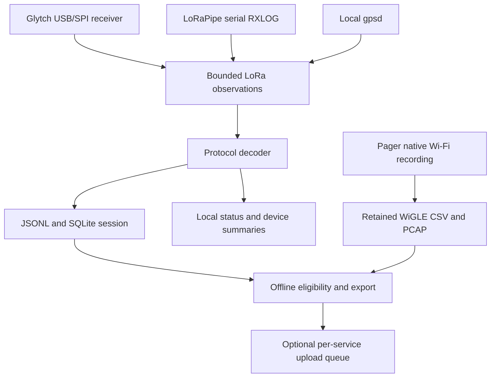

# Architecture and upstream attribution

LORA-Pager-Pipe is a Pager-native, receive-only LoRa observation payload. It
keeps raw packets and radio metadata, performs supported decoding locally, and
can associate a session with the Pager's native Wi-Fi recording. LoRaPipe's
raw-radio interface is the starting point: acquisition, protocol interpretation,
display and export remain separate so a decoder improvement does not require
discarding the original capture.

This is an initial implementation, not a claim of complete LoRaPipe/Kismet
feature parity. Source tests, USB detection, actual RF reception, correct
decoding, GPS measurements and accepted service uploads are separate evidence.
Public release notes must state which of these have actually been observed.

## Hardware changes the implementation

The Glytch Mesh Mod contains an SX1262 accessed through a CH341 USB-to-SPI bridge.
Its USB identity is `1a86:5512`. The published Glytch installer supplies the
Meshtoad E22 mapping: chip select 0, RX enable 1, reset 2, BUSY 4, and IRQ 6, with
DIO2 controlling the RF switch and DIO3 powering the TCXO. These are bridge pins,
not ESP32 GPIOs. The module has no LoRaPipe microcontroller firmware to replace.
[Glytch installer source](https://github.com/glytchtech/Pager-Mod-Docs/blob/9bce98d2a908a3b7b5f5388b0a9443cc06d55b8b/Mesh/payload.sh).

The payload therefore has two distinct radio backends:

| Backend | Connected hardware | Implemented interface |
| --- | --- | --- |
| `glytch` | Glytch CH341/SX1262 Mesh Mod | Pager userspace USB/SPI receiver; the SX1262 controller exposes receive operations only |
| `lorapipe` | A separate compatible device already running LoRaPipe | 115200-baud CLI control and `RXLOG` parsing through PySerial |

The serial backend actually speaks LoRaPipe's `ver`, `rxlog` and `set radio`
commands. It does not implement KISS transport, upload LoRaPipe firmware, or
issue transmit commands. The Glytch backend follows the same raw-observation
design, but it is a different hardware transport. Calling it a firmware port
onto the Glytch module would misdescribe how the module works.
[Reviewed LoRaPipe source and CLI](https://github.com/krak3n77/lorapipe/tree/4ae9f86bb8256f8084f50577128b0facdca7bee2).

## Data flow

`radio.py` controls the SX1262 and returns raw bytes with RSSI, SNR, reception
time, radio settings and CRC status. `lorapipe.py` produces the same observation
shape from a serial `RXLOG` record. LoRaPipe's reported receiver timestamp is
kept separately from the Pager's receipt time; the CLI does not report a CRC
verdict, so that field remains unknown instead of being invented.

`decode.py` interprets only the selected protocol's supported wire format.
Decoded fields describe evidence present in a packet, not assumptions about a
nearby device. Names, positions and roles are absent when unavailable. Encrypted,
unsupported and malformed packets retain raw bytes and an explicit decode state.

`session.py` coordinates the receiver, gpsd reader and storage. Its 256-record
queue separates reception from slow writes. Packet sizes, JSON record sizes and
input buffers are bounded. Receiver, queue-drop, decoder and storage counters
remain visible in the session status. The collector uses a process lock and
refuses to take over a running `meshtasticd` instance.

`uploads.py` operates on closed sessions and derived files. It never deletes
source logs. Upload settings and secrets are separate private configuration;
exports and receipts carry no API credentials. See [upload contracts and
recovery rules](UPLOADS.md).

## Radio scheduling and protocol scope

The SX1262 receives one frequency and modem configuration at a time. Combined
mode alternates one selected Meshtastic profile and one MeshCore profile with a
default 30-second dwell. Traffic sent while another profile is active can be
missed. Reception also depends on frequency, bandwidth, spreading factor,
coding rate, sync word, antenna and signal conditions.

The current profile selection covers US, EU 868 and Australia/New Zealand
starting profiles. It does not claim global channel discovery or every local
MeshCore community preset. A region must be selected before capture. An extra
profile appearing in source does not mean the UI currently exposes it or that it
has been tested on the connected module.

Supported local decoding currently includes Meshtastic headers and recognized
application messages such as node information, advertised position, ordinary
text and device telemetry when a supported public channel key permits decoding.
AES-CTR parsing does not authenticate a Meshtastic message. MeshCore support
includes bounded header parsing, signed public advertisements and supported
group payloads on its supported Public channel. The decoder functions accept
additional channel keys from callers, but this version's capture UI and private
configuration do not expose custom mesh-key entry. Required crypto packages
remain external dependencies; if they are absent, the capture retains raw data
and reports unavailable decoding or verification.

Protocol definitions come from the respective projects:
[Meshtastic protobufs](https://github.com/meshtastic/protobufs) and
[MeshCore packet and payload documentation](https://github.com/meshcore-dev/MeshCore/tree/main/docs).
The local decoder is independently written. No GPL Kismet decoder source is
copied into this payload.

MeshCore path fields require care: a recorded route can represent a forwarding
plan rather than completed hops. The decoder only emits `hop_count` when its
route interpretation establishes completed hops; exporters do not turn an absent
count into zero. Meshtastic's zero `hop_start` is also ambiguous for older
senders. Export requires a trustworthy hop count and observed role; unsupported
roles and unresolved hop semantics stay in the local capture.

## Position and time

The Mesh Mod is not a GNSS receiver. The Pager needs a separately configured
receiver or another verified local gpsd source. The payload subscribes to gpsd;
it does not reconfigure the receiver or discipline the system clock.
[Hak5 GPS setup](https://documentation.hak5.org/wifi-pineapple-pager/gps).

An observation has distinct concepts:

- `timestamp`: Pager system-clock time when received.
- `receiver_gps`: receiver fix information associated with reception, including
  availability, freshness and receiver-reported UTC where available.
- `decoded.node_position`: a mesh sender's advertised position, if decoded.

Missing or expired receiver fixes do not become zero coordinates. The local
freshness threshold is ten seconds. gpsd can send several partial TPV messages
for one epoch; missing fields are not measurements. Receiver-reported time can
also be invalid before a stable fix, so its presence alone does not prove clock
accuracy. [gpsd TPV contract](https://gpsd.gitlab.io/gpsd/gpsd_json.html#_tpv).

A relay can deliver a distant sender's position. The receiver's coordinates,
the advertised coordinates and the original sender identity must remain
separate. A valid MeshCore signature authenticates an advertisement under its
key; it does not establish the truth of a geographic claim.

## Storage and Kismet compatibility

Each session retains a versioned manifest, timestamped JSONL observations and
`capture.sqlite3`, plus a `lora.pcap` containing LoRaTAP v1 frames. SQLite contains separate observation and device-summary
tables. Summaries can coalesce a device for display while observations retain
later sightings and raw packet bytes. Writes are buffered and periodically
flushed; clean shutdown closes the session. A power loss can leave an interrupted
session or trailing partial JSONL record, and recovery must not label that as a
cleanly completed drive.

The independently implemented LoRa PCAP writer uses `LINKTYPE_LORATAP` 270.
LoRaTAP's bandwidth field cannot represent the 62.5 kHz MeshCore preset, so the
PCAP marks that bandwidth unknown and the exact value stays in JSONL/SQLite.
Receiver GPS and decoded mesh fields also remain in the companion records.
Header serialization tests are separate from validation in an installed packet
analyzer. [LoRaTAP link-type registration](https://www.tcpdump.org/linktypes/LINKTYPE_LORATAP.html),
[Wireshark format reference](https://github.com/wireshark/wireshark/blob/master/epan/dissectors/packet-loratap.c).

This database is **not a `.kismet` file**. Kismet's database has its own schema,
tracked objects and tooling contracts. Sharing SQLite as a storage engine does
not establish import compatibility. Native Pager WiGLE CSV and PCAP are kept as
separate artifacts; the current payload does not promise a combined KismetDB
export or replay into Kismet. [KismetDB format](https://www.kismetwireless.net/docs/readme/logging/kismetdb/).

Kismet's LoRaPipe datasource is the reference for the radio/host separation.
Full Kismet supplies its own datasource management, device tracking, decoding,
web interface and logging. This payload implements a smaller local workflow and
must be compared feature by feature, not advertised as identical or superior
without measurements. [Kismet LoRaPipe datasource](https://www.kismetwireless.net/docs/readme/datasources/lora-lorapipe/).

## Native Pager integration

The payload keeps the normal Pager services available and uses native menus,
dialogs and image presentation. It does not replace system firmware or install
a custom compiled UI binary. This matches Hak5's current source-inspection
requirements for contributed payloads. PyUSB 1.3.1 is included as inspectable,
unmodified Python source under `payload/lib/usb/` because the checked Pager feed
does not provide it. The entry point adds the payload's `lib/` directory to its
own import path. Native runtime libraries come from the configured package feed
and belong on MMC; firmware upgrades require dependency checks.
[Hak5 advanced payload guidance](https://documentation.hak5.org/wifi-pineapple-pager/payloads-1/advanced-payloads).

Native Wi-Fi recording is owned by the Pager's Recon controls. A combined drive
must attach the correct finished native files to the LoRa session before export.
The payload must not stop another application's recording or silently substitute
an unrelated loot file. Wi-Fi channel hopping across 2.4, 5 and 6 GHz is distinct
from LoRa profile switching; neither radio receives every channel simultaneously.
[Native WiGLE commands](https://documentation.hak5.org/wifi-pineapple-pager/wifi-pineapple-commands/wigle),
[native PCAP commands](https://documentation.hak5.org/wifi-pineapple-pager/wifi-pineapple-commands/wifi_pcap).

## License and attribution

The project's original payload, capture, decode and exporter code is MIT
licensed. Third-party components retain their own licenses. Project branding
does not imply endorsement by Hak5, Glytch, LoRaPipe, Kismet, Meshtastic,
MeshCore or an upload service.

| Component | Use and provenance | License handling |
| --- | --- | --- |
| openHop Core CH341 transport | The single `vendor/ch341.py` module is an unmodified copy from commit `e07722ea96093752ac8b3c6772d653f8b68224bf`; no openHop mesh router or transmit service is initialized | MIT, copyright 2025 Lloyd Newton; full notice retained in `vendor/LICENSE.openhop` |
| PyUSB 1.3.1 | Unmodified Python source extracted from the verified universal PyPI distribution, bundled in `payload/lib/usb/`; no wheel or compiled extension ships in the payload | BSD 3-Clause, copyright Wander Lairson Costa and PyUSB contributors; complete notice retained in `payload/lib/usb/LICENSE` |
| LoRaPipe | Raw-radio architecture and a real CLI/RXLOG interoperability backend, reviewed at `4ae9f86bb8256f8084f50577128b0facdca7bee2`; MCU firmware is not bundled or flashed by this payload | Upstream MIT notice credits Scott Powell / rippleradios.com, 2025; preserve it if firmware or source is later redistributed |
| Kismet | Datasource/logging reference, not a bundled runtime or copied decoder | No Kismet source incorporated |
| Meshtastic and MeshCore | On-air format specifications used for original local parsers | No upstream decoder implementation incorporated |
| WiGLE, Wardrift and WDGWars integrations | Interchange/authentication reference for original upload code | Sources and limits listed in `UPLOADS.md`; no uploader implementation copied |
| Hak5 and Glytch documentation | Pager lifecycle, native capture and hardware mapping reference | Documentation referenced; system firmware is not redistributed |

The actual openHop repository name uses an underscore:
[openhop-dev/openhop_core](https://github.com/openhop-dev/openhop_core/tree/e07722ea96093752ac8b3c6772d653f8b68224bf).
The copied CH341 file's SHA-256 is
`20e3d115c33b00b06afb464d9a9c79a1ff74fef740869cb66e6eff13555fbdb6`.
Its bytes were compared with the pinned upstream source. The payload includes
the source record at `lib/lpp/vendor/SOURCES.md` and full MIT notice at
`lib/lpp/vendor/LICENSE.openhop`. The
[pinned upstream license](https://github.com/openhop-dev/openhop_core/blob/e07722ea96093752ac8b3c6772d653f8b68224bf/LICENSE)
is also available for review.

LoRaPipe's notice is available at the
[reviewed upstream license](https://github.com/krak3n77/lorapipe/blob/4ae9f86bb8256f8084f50577128b0facdca7bee2/license.txt).
PyUSB's source distribution was extracted from `pyusb-1.3.1-py3-none-any.whl`,
SHA-256 `bf9b754557af4717fe80c2b07cc2b923a9151f5c08d17bdb5345dac09d6a0430`.
The full development checkout's `tools/vendor_pyusb.py` reproduces the source
extraction after verifying that checksum; this development utility is not part
of the installed payload. The source and its original BSD notice remain together in the
submission. [PyUSB release](https://pypi.org/project/pyusb/1.3.1/),
[PyUSB upstream](https://github.com/pyusb/pyusb).

libusb, PySerial, Python and cryptographic runtime libraries are installed
separately under their own licenses. `python3-cryptography` provides both AES
and Ed25519 operations; official Pager package 41.0.7 was loaded during
development. These dependencies and bundled PyUSB are not relicensed under
this project's MIT license.

## Validation boundary

Before requesting upstream acceptance, record the installed Pager firmware,
dependency versions, module identity, selected profiles and a repeatable hardware
check. Exercise start/stop, missing GPS, a known Meshtastic transmission, a known
MeshCore advertisement, invalid crypto, profile switching, disconnected USB,
low storage, interrupted logging and upload recovery. Preserve redacted evidence
without publishing private keys, live capture contents or precise drive routes.

A passing parser fixture establishes expected software behavior on that fixture.
It does not establish sensitivity, packet-capture completeness, continuous
multiband reception, live service acceptance or compliance with every upstream
review expectation. Keep those claims tied to their corresponding tests.
