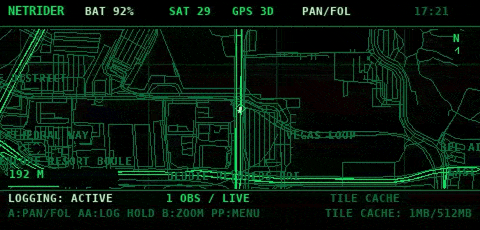
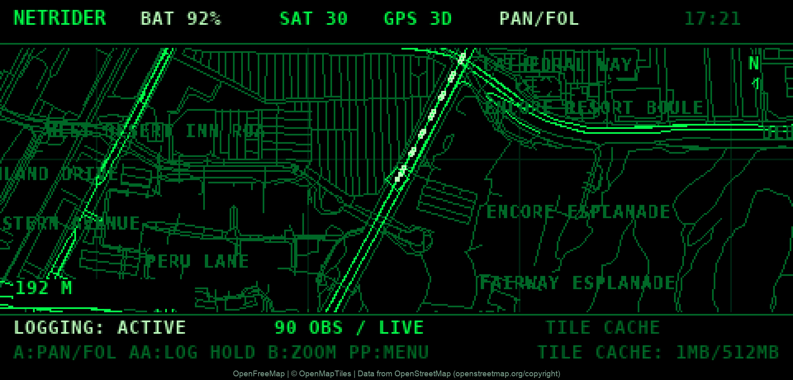

<div align="center">

# NetRider

**A native map, GPS and Wi-Fi logging interface for the Hak5 WiFi Pineapple Pager.**

[Download](https://github.com/glytchtech/NetRider/releases/latest) · [Payload Hub launcher](https://github.com/hak5/wifipineapplepager-payloads/tree/master/library/user/reconnaissance/NetRider) · [Report an issue](https://github.com/glytchtech/NetRider/issues)

</div>



---

## Overview

NetRider puts the map, your GPS position and Wi-Fi logging controls on the Pager's screen. Pan, zoom, and inspect your logs. Switch to follow and start logging.

The interface is rendered natively for the Pager's **480 × 222 display**, with a green-on-black presentation and physical-button controls.

### Highlights

- **Pan and Follow modes** with quick zoom controls.
- **GPS status and diagnostics** in the app.
- **Wi-Fi logging controls** and WiGLE trail visualization.
- **Map tile caching** for areas downloaded in advance.
- **Optional Start on Boot** and an in-app update check.
- **First-launch briefing** with an animated Pager model and button callouts.

## Install

### From Payload Hub

Install **NetRider** from the **Reconnaissance** category on device, in **Payload Portal**, then launch it.

If the native executable is missing, the launcher asks permission to download it from the repository's GitHub Releases. An Internet connection is required for that first download. Declining leaves the executable uninstalled.

### Manual installation

1. Open the [latest release](https://github.com/glytchtech/NetRider/releases/latest).
2. Download **`payload.sh`**.
3. Create this directory on the Pager and place `payload.sh` inside it:

   ```text
   /root/payloads/user/reconnaissance/NetRider/
   ```

4. Launch **NetRider** from the Pager's Reconnaissance menu and approve the download.

The release's `netrider-update.txt` is the metadata consumed by the installer and updater. It is not a payload to run.

## Map view



## Controls

| Button or gesture | On the map |
| :--- | :--- |
| D-pad | Pan |
| Hold **B** + D-pad **Up / Right** | Zoom in |
| Hold **B** + D-pad **Down / Left** | Zoom out |
| Tap **A** | Toggle Follow |
| Double-tap **A** | Toggle Wi-Fi logging |
| Double-tap **Power** | Open or close the main menu |

Inside menus: **D-pad** navigates, **A** selects and **B** goes back.

On first launch, press **A** to advance through all three briefing pages.

## Before you head out

- **Firmware:** requires **2.0.0 or newer**.
- **GPS:** a working GPS source is needed for a live position and location-based trails. Check the GPS diagnostics screen if a fix is unavailable. Glytch GPS Mod Pro is recommended for best results.
- **Maps:** download/cache the areas you need while connected. Uncached map tiles still need network access.
- **Updates:** use the update check in Settings.

## Release repository

The [NetRider release repository](https://github.com/glytchtech/NetRider) distributes the application release assets. The stable Payload Hub launcher downloads the native application separately, so ordinary app updates do not require replacing the launcher.

For bug reports, include your Pager firmware version, NetRider version, the steps to reproduce the problem and any relevant error text. Remove credentials and private survey information before sharing logs.

---

**By Glytch.** Built for the Hak5 WiFi Pineapple Pager. Use only where you have authorization to collect wireless survey data.

