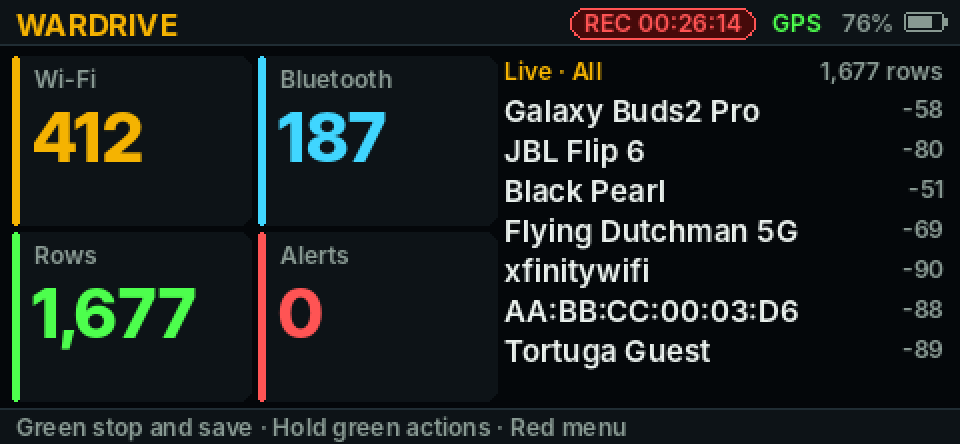

# Quartermaster for the WiFi Pineapple Pager

Wardrive Wi-Fi, Bluetooth and LoRa mesh nodes from the Pager, with WiGLE logs, uploads, Drive Alerts and Recon.
It is the same Quartermaster that runs on the M5Stack CardputerZero, with screens drawn for the Pager's wide display
and controls made for the D-pad and the two buttons.

## What it does

- **Wi-Fi wardriving** from the Pager's own monitor radio (PineAP's `wlan1mon`) on 2.4, 5 and 6 GHz. Quartermaster
  only listens: PineAP keeps its channel hopping and keeps running.
- **Bluetooth LE wardriving** from the Pager's Bluetooth radio. It only listens and never connects or pairs.
- **LoRa mesh nodes** (Meshtastic and MeshCore) and LoRaWAN, from a USB LoRa radio that is found by itself:
  - MeshToad, MeshStick, the Glytch Mesh Mod, RAK19714, uMesh and other CH341 sticks (USB `1a86:5512`). A free stick
    is driven directly and listens on Meshtastic, MeshCore and LoRaWAN in turn.
  - A stick or radio that `meshtasticd` already runs on the Pager is read through `meshtasticd` and is left in its care.
  - A Meshtastic board on USB (Heltec, LilyGO, RAK4631 and others) is read through its own firmware. Nothing is sent
    and no setting is changed.
- **USB Wi-Fi adapters** plugged into the Pager (through a hub) wardrive too, as on the CardputerZero.
- **GPS** from a USB GPS or from `gpsd`.
- **WiGLE CSV logs** in `/root/loot/quartermaster`, with uploads to WiGLE, WDGWars and Wardrift.
- **Drive Alerts** for Flock cameras, Axon body cameras, Meta glasses and more, with buzzer tones and vibration.
- **Recon** of nearby Wi-Fi and Bluetooth devices, with the lists from SquachWatch.
- **Quartermaster Nodes** added by hand under Settings > Nodes.

## Install

1. Copy this folder to `/root/payloads/user/reconnaissance/quartermaster/` on the Pager.
2. Open **Payloads > Reconnaissance > Quartermaster** on the Pager.
3. The first time, Quartermaster asks to install `python3`, `python3-pillow` and `python3-pyserial` from the Pager's
   package feed to its storage (`opkg -d mmc`). The Pager needs internet for this. Nothing else is downloaded.

## Controls

| Button | What it does |
| --- | --- |
| D-pad | Move. Held arrows repeat. |
| Green | Open or choose. On the wardrive screen it stops and saves. |
| Hold green | Actions for this screen. |
| Red | Back. On a Drive Alert it hides the alert. |
| Hold red for 2 seconds | Leave Quartermaster and give the screen back to the Pager. |

The screen stays lit while Quartermaster runs. To let it turn off, pick a time under **Settings > Screen timeout**.
Any button wakes it, and that press does nothing else.

## Upload keys

Keys are never written in `payload.sh`. Enter them under **Keys** on the Pager with the on-screen keyboard, or open
**Keys > Phone setup** and scan the QR code with a phone on the same network.

## Quartermaster Nodes

Node firmware does not come with this payload, as payloads hold no binaries. Flash a node from a computer at
https://valleytechsolutions.github.io/Quartermaster/flasher/, then plug it into the Pager and add it under
**Settings > Nodes**.

## Files

| Path | What it is |
| --- | --- |
| `/root/loot/quartermaster/` | Logs, settings, keys and `errors.log` |
| `/tmp/quartermaster.log` | What the last start printed |

## Good to know

- Listening only: Quartermaster never transmits on LoRa, never deauthenticates and never joins a network.
- Respect local laws and privacy. Upload only what you are allowed to collect.

## Source and credits

Source, tests and releases: https://github.com/valleytechsolutions/Quartermaster-Pager. The core is
[Quartermaster](https://github.com/valleytechsolutions/Quartermaster) by Valleytech Solutions, GPL-3.0.

- SquachWatch, created by Talking Sasquach, through
  [SquachWatch-CYD](https://github.com/skizzophrenic/SquachWatch-CYD) by skizzophrenic, GPL-3.0: detection types,
  address prefixes, evil twin, flood and burst checks, and the LoRaWAN frame layout.
- [Dragon Detector](https://github.com/valleytechsolutions/dragon-detector) by Valleytech Custom Solutions, MIT.
- [flock-you](https://github.com/colonelpanichacks/flock-you) by colonelpanichacks, MIT, with research by
  NitekryDPaul, DeFlockJoplin and wgreenberg.
- OUI Spy, Unified Blue and AXEOFF by colonelpanichacks, MIT. [nyanBOX](https://github.com/jbohack/nyanBOX) by
  jbohack, MIT. ESP32 Marauder by justcallmekoko.
- Meshtastic's device configurations for the CH341 LoRa sticks' pins, and its stream API.
